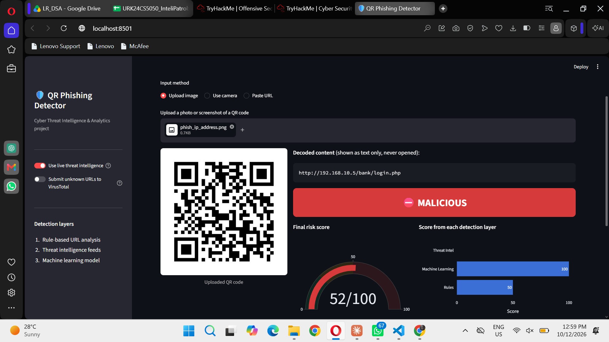

# QR Code Phishing Detector

A multi-layer threat intelligence system that detects **quishing** (QR code phishing): it decodes a QR code, inspects the hidden link **without visiting it**, and gives a **Safe / Suspicious / Malicious** verdict with plain-English reasons.

*Project for the course Cyber Threat Intelligence and Analytics, Karunya Institute of Technology and Sciences.*



## How it works

```
QR image ──► Decoder ──► URL (shown as text, never opened)
                              │
          ┌───────────────────┼────────────────────┐
          ▼                   ▼                    ▼
   Layer 1: Rules      Layer 2: Threat Intel   Layer 3: ML model
   lexical red flags,  VirusTotal (70+ vendors), Random Forest on
   brand impersonation, OpenPhish feed, WHOIS   domain features
   typosquatting,      domain age, redirect     (PhiUSIIL, 235k URLs)
   abused TLDs         chain, Tranco reputation
          └───────────────────┼────────────────────┘
                              ▼
                 Risk engine (weighted score + IOC override)
                              ▼
            Verdict + reasons ──► scan log ──► analytics dashboard
```

| Layer | Weight | What it catches |
|---|---|---|
| Rules | 35% | IP-address hosts, lookalike brands (`paypa1`), typosquats (`robiox`), shorteners, abused TLDs, phishing keywords |
| Threat intelligence | 30% | URLs already reported by security vendors or phishing feeds; brand-new domains; hidden redirects |
| Machine learning | 35% | New ("zero-day") phishing domains no blacklist knows yet |

A URL confirmed by threat intelligence (3+ VirusTotal vendors, or listed on OpenPhish) is always **Malicious**, whatever the other layers say.

## Results

Real-world test: **300 live phishing URLs** (OpenPhish) + **156 legitimate URLs**, each encoded into a QR code and decoded back. Live feeds were switched off to measure zero-day detection.

| Method | Accuracy | Precision | Recall | F1 | False alarms |
|---|---|---|---|---|---|
| Rules only | 54.8% | 100% | 31.3% | 47.7% | 0.0% |
| ML only | 79.4% | 91.5% | 75.7% | 82.8% | 13.5% |
| Rules + ML | 82.9% | 92.0% | 81.0% | 86.2% | 13.5% |
| **Full system (+ reputation)** | **85.1%** | **99.6%** | **77.7%** | **87.3%** | **0.6%** |

QR decoding success: **100%**. Average analysis time: about 80 ms per QR code (offline mode).

### Key findings
- **Two dataset biases** in PhiUSIIL: every legitimate URL is an https homepage, and 97% start with `www.`. A model trained on full URLs learns these shortcuts. Training on registered-domain features only fixed about 20% false alarms on real URLs.
- **Layering works.** Each layer covers another's blind spots; domain reputation cut false alarms from 13.5% to 0.6%.
- **Limitation.** Attackers host phishing on reputable platforms (dynamic DNS, GitBook, cloud servers) to borrow their reputation. Live feeds cover this in deployment.

## Run it yourself

```bash
python -m venv venv
venv\Scripts\activate            # Windows  (Mac/Linux: source venv/bin/activate)
pip install -r requirements.txt

python download_dataset.py       # PhiUSIIL dataset (UCI)
python download_reputation.py    # Tranco top sites list
python train_model.py            # trains and compares 3 models
streamlit run app.py             # opens the web app
```

Optional: create a `.env` file with `VIRUSTOTAL_API_KEY=your_key` (free key from virustotal.com) to enable VirusTotal lookups.

Evaluation: `python evaluate.py` (real-world test) or `python evaluate.py --heldout` (fresh, never-seen phishing URLs).

## Project structure

| File | Purpose |
|---|---|
| `qr_decoder.py` | Reads QR codes from images (OpenCV, with image clean-up and a backup detector) |
| `url_features.py` | Layer 1: rule-based URL analysis |
| `threat_intel.py` | Layer 2: VirusTotal, OpenPhish, WHOIS, redirect checks |
| `reputation.py` | Layer 2: offline domain reputation (Tranco) |
| `ml_features.py`, `train_model.py` | Layer 3: feature extraction and model training |
| `risk_engine.py` | Combines all layers into one verdict; logs scans |
| `app.py` | Streamlit web app: scan, analytics dashboard, model performance |
| `evaluate.py` | Real-world and held-out evaluation |

## Data sources
- Prasad, A. & Chandra, S. (2024). *PhiUSIIL Phishing URL Dataset*. UCI Machine Learning Repository.
- Le Pochat, V. et al. (2019). *Tranco: A Research-Oriented Top Sites Ranking Hardened Against Manipulation*. NDSS.
- OpenPhish community feed, https://openphish.com
- VirusTotal API v3, https://www.virustotal.com

## Safety
The tool never opens or renders a decoded link. Redirect checks use HTTP `HEAD` requests only. API keys are kept in `.env`, which is excluded from version control.
